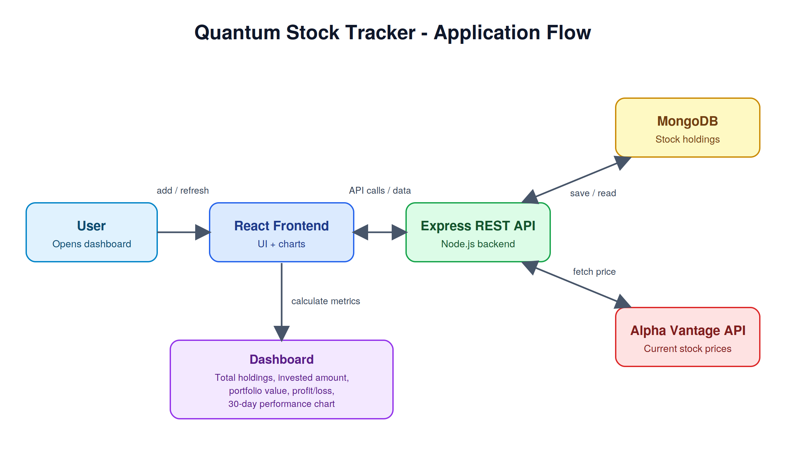

1. Overview

Quantum Stock Tracker is a MERN stack web application for tracking a personal stock portfolio. Users create a profile for each stock they hold. The app fetches the current price from the Alpha Vantage API and calculates the overall profit or loss.

2. Features 
 
Stock profiles

•	Create, view, edit, and delete stock holdings

•	Each profile stores the stock name, symbol, quantity, buy price, and other relevant details

•	Current price fetched from the Alpha Vantage API
Dashboard and analytics

•	Total holdings: number of stocks in the portfolio

•	Total invested amount: cost basis across all holdings

•	Current portfolio value: calculated from live prices fetched from the API

•	Profit / Loss: current value minus invested amount

•	30-day performance area chart (uses simulated data)

•	Refresh button to pull the latest prices on demand

3. Application Flow

4. Tech Stack
  Layer	Technology
Frontend	React, [charting library, e.g. Recharts]
Backend	Node.js, Express
Database	MongoDB (Mongoose)
External API	Alpha Vantage

5. Getting Started
Prerequisites: Node.js (v18 or later), MongoDB (local or Atlas), and a free Alpha Vantage API key.
Installation
git clone https://github.com/adijoshi07/stock_portfolio_tracker
.git
cd stock_portfolio_tracker
cd server && npm install
cd ../client && npm install
Environment variables (create a .env file in the server folder)
MONGO_URI=your_mongodb_connection_string
ALPHA_VANTAGE_API_KEY=your_api_key
PORT=5000
Run the app
cd server && npm start
cd client && npm start

6. API Endpoints
Update this table to match your actual routes.
Method	Endpoint	Description
GET	/api/stocks	Get all stock holdings
POST	/api/stocks	Add a new stock
PUT	/api/stocks/:id	Update a stock
DELETE	/api/stocks/:id	Delete a stock
GET	/api/stocks/refresh	Fetch latest prices from Alpha Vantage

7. Notes and Limitations

•	The 30-day performance chart currently uses simulated data, not real historical prices.

•	The Alpha Vantage free tier has request limits, so refreshing many stocks at once may hit the limit.

8. Future Improvements

•	Replace simulated chart data with real historical prices from the API

•	Cache prices on the backend to reduce API calls

•	Add user authentication so each user has a private portfolio

•	Add price alerts and a sector-wise portfolio breakdown
